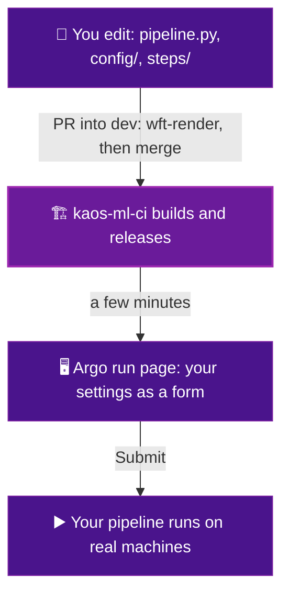

# How it works

This page has no tasks. It is a short read so the rest of the guide makes sense. Five minutes and you will get the whole idea.

## Three files, three jobs

- :material-file-tree: **`pipeline.py`**

    ---

    Your list of steps. It says what the steps are and what order they run in. Nothing else.

- :material-tune-vertical: **`config/`**

    ---

    Your settings. Each one turns into a field on the run page that a person can change.

- :material-package-variant-closed: **`steps/`**

    ---

    Your code. One folder per step, each with a small program and a Dockerfile.

That is the whole thing you own. Everything else is the platform.

## What the platform does for you

When you send your files in, the platform takes over. You do not set any of this up.

- It builds each step into an image, which is a small self contained box.
- It reads your `config/` and turns every setting into a field on a web page.
- It picks the right machine for each step, with or without a graphics card.
- It hands your steps the addresses and credentials they need for lakeFS and MLflow.
- It checks your work and tells you on GitHub if something is off.

## Good to know

- **Your pipeline is named after your app** (`<app>-pipeline`), whatever `pipeline.py` says, so two
  apps in one project never overwrite each other. Step images are likewise per app.
- **Your `pipeline.py` is rendered without any credentials.** Only the platform's own release step
  can publish; your code cannot reach tokens at render time.
- **The repository is the source of truth.** The pipeline the platform runs is built from your
  `dev` branch. A change made anywhere else, such as a hand edit of the released pipeline, is
  replaced by the next release. Make every change in the repository.
- **Each step gets its own machine and disk.** Steps do not share files; they pass small values
  with `outputs=` and larger data through lakeFS ([Write results from a step](write-a-step.md)).
- **GPU nodes are sized to fit.** A GPU step asks for what a whole GPU node can really offer, so it
  is not left waiting for a machine that cannot exist.
- **Older pipelines** may still have the helper folder `kubecore/` where new ones have
  `kaos_pipeline/`. It works the same; nothing needs to be renamed.

## Where data and results live

- **Datasets** are lakeFS repositories `dataset-<name>`, versioned with tags `v1`, `v2`, … A run
  picks one in the `dataset` field. Its first step, `dataset-loading`, pins it to one commit, and
  every later step reads that commit ([Datasets](datasets.md)).
- **Results** go to your app's `outputs-<app>` repository, one commit per step per run, written with
  kaos-lib ([Results](results.md)).
- A step never writes to a dataset.

You describe what you want. The platform figures out how to run it.

## What happens when you push

The values you set on the form get combined with your settings into one file before anything heavy runs. Every step receives that file. It is also saved, so any run can be repeated exactly.

## The one rule worth remembering

!!! quote "Remember this"
    You describe **what** each step is. The platform handles **how** it runs.

You never write a server address. You never write a password. You never pick a machine by hand. You say what your step needs, and the platform wires it up.

Ready to build something. Go to [Add a step](add-a-step.md), or follow [the guide](guide-step-with-data.md) for a step that reads the dataset.
