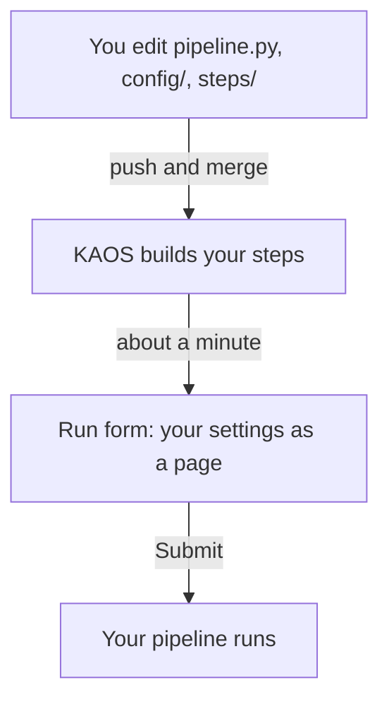

# How it works (optional)

This page has no tasks. Read it if you want the idea behind the cookbook.

## Three things you own

- **`pipeline.py`**: your list of steps and their order.
- **`config/`**: your settings. Every setting becomes a field on the run form.
- **`steps/`**: your code, one folder per step, each with a small program and a Dockerfile.

## What happens when you push

1. You push your change to the code repository and merge it after the check passes.
2. KAOS builds an image of every step whose code changed. An image is a self-contained box with your code and its libraries.
3. Your settings become the run form. The values you pick are combined into one file that every step receives, and it is saved so any run can be repeated exactly.
4. Each step runs on the machine class you chose. Your steps get access to your data and MLflow without you handling any passwords.

## The one rule

You describe **what** each step is. KAOS handles **how** it runs.
