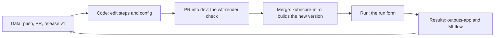

# The engineer's cookbook

You are an ML or software engineer and you have just been added to a KAOS project. This cookbook
takes you through your first day. By the end of it you have built a pipeline end to end, run it on
your own data, and you are comparing the trained weights of two runs.

Read the chapters in order the first time. Each one says what it is for, who is allowed to do it,
what to click or paste, what you should see, what to do if you don't, and where to go next.

| | chapter | at the end of it you have |
|---|---|---|
| 1 | [You're in](cookbook/1-youre-in.md) | signed in to the console; you have found your organisation, your project and your role |
| 2 | [Your project's apps](cookbook/2-your-apps.md) | an ML app, either an existing one or one you created from this template, cloned on your computer |
| 3 | [Your tools](cookbook/3-your-tools.md) | the run page, lakeFS, MLflow, the console's Datasets page and GitHub open in your browser |
| 4 | [Install kaosctl and sign in](cookbook/4-install-kaosctl.md) | the `kaosctl` command, signed in to your project |
| 5 | [Your data](cookbook/5-your-data.md) | a dataset with your files, released as `v1` and ready to share |
| 6 | [Your pipeline](cookbook/6-your-pipeline.md) | the shipped pipeline run once, and then your own step added, checked and live |
| 7 | [Run it](cookbook/7-run-it.md) | a run started from the form, watched, its logs read, and retried if needed |
| 8 | [Results and weights](cookbook/8-results-and-weights.md) | your run's outputs and its MLflow run, with two runs compared |
| 9 | [The yolo use case](cookbook/9-the-yolo-use-case.md) | the same day with the yolo template: labelled images, two trainings compared, weights picked |
| 10 | [When things go wrong](cookbook/10-when-things-go-wrong.md) | a fix for the symptom in front of you |

## The loop you will repeat

## The rest of the site

The cookbook links into these pages for the details:

- **Guides** walk one task from start to finish: [first dataset and run](first-run.md),
  [add a step that reads the dataset and writes a result](guide-step-with-data.md), and
  [run on a released version and find the result](guide-run-on-a-version.md).
- **Datasets** are explained once, in the kaos-lib guide: [Datasets](https://storage.googleapis.com/kaos-dev-511509-kaos-lib/docs/datasets.html) (versions, layouts,
  the commands, the browser), [datasets shared with your project](https://storage.googleapis.com/kaos-dev-511509-kaos-lib/docs/shared-datasets.html) and
  [how steps use datasets](https://storage.googleapis.com/kaos-dev-511509-kaos-lib/docs/steps-and-datasets.html).
- **Pipelines**: [how it works](how-it-works.md), and pages on adding, writing and removing a step,
  changing a setting, sending a change in, and running.
- **[Results](results.md)**, **[Run on HPC (Slurm)](hpc.md)** and a **[word list](glossary.md)**.
- In the kaos-lib guide as well: [long runs and checkpoints](https://storage.googleapis.com/kaos-dev-511509-kaos-lib/docs/checkpoint.html),
  [checking and trying a step on your computer](https://storage.googleapis.com/kaos-dev-511509-kaos-lib/docs/lint.html) and
  [kaos-lib versions and upgrades](https://storage.googleapis.com/kaos-dev-511509-kaos-lib/docs/support-window.html).

kaos-lib, the library behind `kaosctl` and `import kaos_lib`, has its own reference:
[the kaos-lib reference](https://storage.googleapis.com/kaos-dev-511509-kaos-lib/docs/index.html).

!!! note "Using the yolo template?"
    The [yolo pipeline guide](https://novelcore.github.io/yolo-pipelines-template/) covers the same
    day for the yolo training pipeline. It links back to these chapters for everything the two
    templates share.
